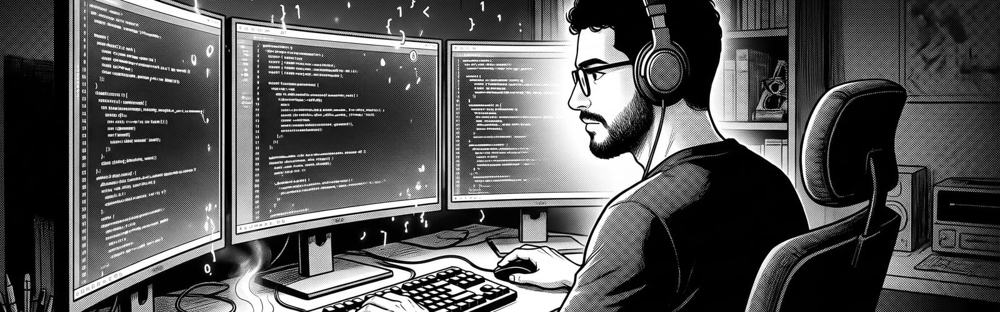

# Feres Nefzi

**Software & AI Engineer** · Tunis, UTC+1 · open to remote and on-site roles

Front-end engineer at InstaDeep since 2023, building the interfaces of AI products.
On my own time I build the AI itself: computer vision, audio and agents.

**[Portfolio](https://iknight18.github.io)** · **[CV (PDF)](https://iknight18.github.io/feres-nefzi-cv.pdf)** · **[LinkedIn](https://www.linkedin.com/in/feres-nefzi)** · **[Email](mailto:feresnefzi18@gmail.com)**

## Projects

**[DJ Engine](https://github.com/iknight18/dj-engine)** · Rust, Python\
An automatic DJ. It analyses a music library (beats, key, phrases, energy, stems split with Demucs), then
mixes it live on two decks: it picks the next track and the transition, beatmatches on the downbeat, and
streams the set to Icecast.

**[FlashLink](https://github.com/iknight18/flashlink)** · TypeScript, Expo, Vite\
Text sent through a phone's flashlight. Framed, CRC-checked and Manchester-coded light, decoded from any
camera in the browser, with a simulator that tests the decoder against jitter and noise.

**[Theater Pose Estimation](https://github.com/iknight18/Theater-Detection)** · Python, YOLOv8, FastAPI\
Detects every actor on stage and their skeleton, with a confidence score for each joint, since costumes,
props and stage lighting make theatre a hard case. A research base for analysing staging and movement.

More projects, with screenshots, on the **[portfolio](https://iknight18.github.io)**.

## Stack

- **Product:** TypeScript, React, Next.js, Node, NestJS, Tailwind, design systems
- **AI & audio:** Python, YOLO / Ultralytics, Hugging Face Transformers, librosa, madmom, Demucs, Claude & Gemini APIs
- **Systems:** Rust, FastAPI, Docker, Kubernetes, Postgres, Redis
